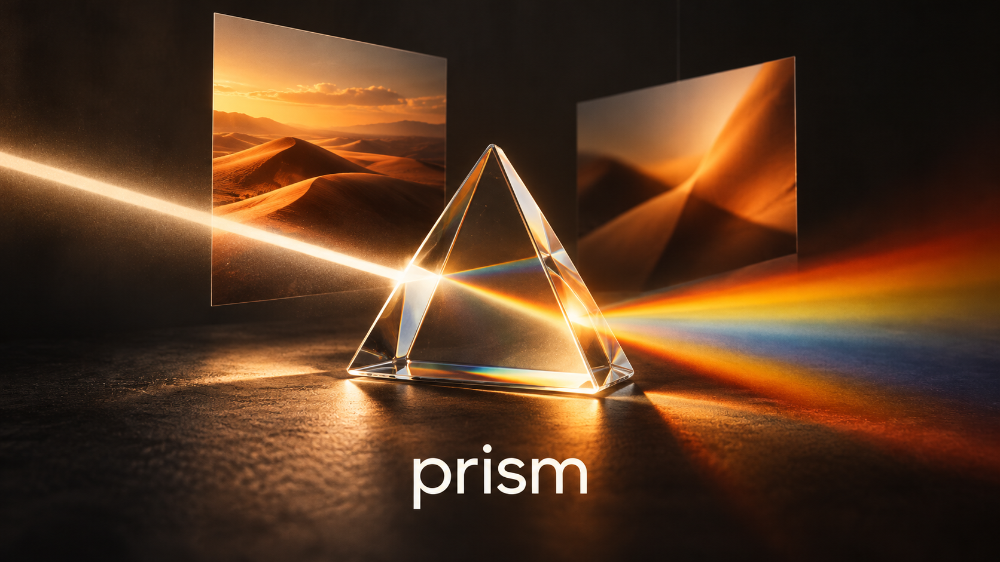

# Prism

A private browser photo studio built on miniPaint's real image-editing engine.
Charcoal workspace, warm orange controls, local projects and no account, Docker, backend or API keys.

## Run

Node.js 20.19+ or 22.12+ is required for development.

~~~sh
npm ci
npm run dev
~~~

Open the printed local URL, normally http://127.0.0.1:3002.

## Build and deploy

~~~sh
npm run build
~~~

Publish dist/ on a static host. The root project installs only Vite.
The editor runtime is bundled locally; it is not an embed from an external website.
Relative asset paths support deployment under a subdirectory.
Solvante's own compiler still needs testing on that platform.

## Features

Real miniPaint drawing, layers, text, selections, crop, resize, rotation, color correction, effects, undo and redo.
Prism adds a searchable project library, favorites, duplication, renaming, automatic browser-local saving,
editable .prism backups and import, plus full-resolution PNG, JPEG and WebP exports.
The engine's menus retain additional local editing tools and formats.

Open an image or start from a blank canvas or size preset. Sample projects are original procedural illustrations.
The landscape marketing cover was generated using the built-in image generation tool; its prompt is in assets/cover-prompt.md.

## Storage and limits

Projects and raster data are stored in IndexedDB on the user's own device and browser origin.
Closing and reopening the browser retains saved projects.
Clearing site storage, private browsing, browser eviction, or using a different domain/profile can remove or isolate them.
Download editable backups of important work. Save failures are reported, and pending saves trigger an exit warning.

No cloud sync, collaboration, stock-image search, external font service, AI generation or API keys.
Text uses system fonts. GIF import uses a still frame.
Prism's primary import and new-canvas flows allow up to 16 megapixels and 30 MB per file.
Some GPU-accelerated engine effects depend on browser WebGL support.
The advanced editor menus can create larger canvases; avoid large files on low-memory devices.

## Open-source attribution

miniPaint 4.14.3 by Vilius L.: https://github.com/viliusle/miniPaint, upstream commit a79733eb803fc97084ef0ee4faa96b031e69e1c0.
This is an independent project, not an official miniPaint release.
miniPaint's MIT notice remains in vendor/miniPaint/MIT-LICENSE.txt.
Third-party licenses and copyright notices ship in public/licenses/ and in the production build.
See THIRD_PARTY_NOTICES.md.

The upstream Alertify notification dependency was replaced with first-party MIT code in editor-notifications.js
and editor-notifications.css. The editor bundle was rebuilt from source without Alertify.
Remote service credentials are stripped by scripts/prepare-editor.mjs.

## Rebuild the editor

Only needed after changing miniPaint's engine source, not for normal app compilation.
The bundled runtime makes the ordinary browser/WebContainer build small.

~~~sh
cd vendor/miniPaint
npm ci --ignore-scripts
NODE_OPTIONS=--max-old-space-size=640 npm run build
cd ../..
npm run build
~~~

The modified Webpack configuration aliases legacy notification imports to Prism's first-party replacement.
Minification uses one process to limit memory pressure.

## Verification

scripts/verify.cjs covers real drawing, local autosave, reload and browser-restart persistence,
image exports, backup import, raster import, duplication, favorites, search, mobile layout and external requests.
Install Playwright separately as a test tool, or set PRISM_PLAYWRIGHT_PATH to an existing package directory.
Optionally set PRISM_BROWSER_EXECUTABLE to a Chrome executable.
Run node scripts/verify.cjs while the production preview serves port 3002.
